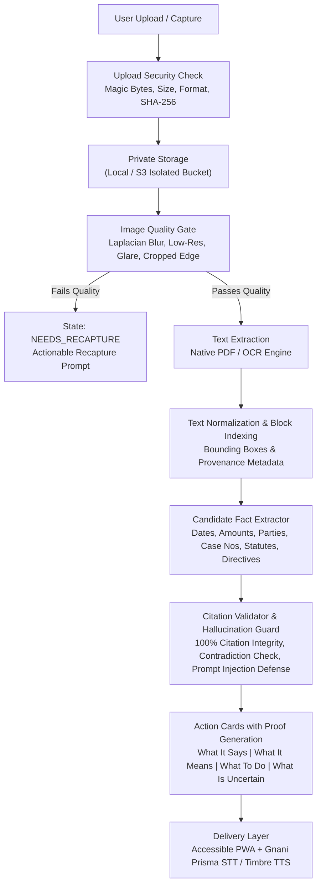

# NoticeSaathi — Architectural Design Document

## 1. System Mission & Philosophy

NoticeSaathi is an evidence-first, accessible document comprehension companion engineered specifically for older adults, individuals with low vision, deaf or hard-of-hearing citizens, and people facing language or literacy barriers.

The foundational principle of NoticeSaathi is:
> **PROOF BEFORE EXPLANATION. NEVER INVENT WHAT THE EVIDENCE DOES NOT SUPPORT.**

Unlike generic conversational bots that extrapolate or generate plausible-sounding assumptions, NoticeSaathi enforces strict deterministic checks: every claim must resolve to verified passages in the user's document, high-impact facts (dates, amounts, legal sections, directives) are checked individually, and the system abstains or marks information as uncertain when text is unclear.

---

## 2. Three-Source Evidence Model

The application strictly separates three distinct classes of information:

| Information Class | Source | Permitted Use | Strict Boundary |
| :--- | :--- | :--- | :--- |
| **Document Evidence** | Visible text and bounding boxes from the uploaded PDF or photograph. | Primary evidence for what the notice states. | Not treated as proof that the document is authentic or legally binding. |
| **User Context** | User's spoken/typed statements (e.g. "My neighbour said this was from court"). | Helps focus retrieval query and determine user intent. | **NEVER** treated as proof of document facts. Cannot supply a missing date or case number. |
| **Approved External Reference** | Authoritative statutory definitions with verified jurisdiction and effective date. | Clarify legal sections cited in the notice. | Unverified statutory citations default to an explicit disclaimer stating the meaning cannot be confirmed. |

---

## 3. End-to-End Processing Pipeline

### Stage Details

1. **Secure Upload & Isolation**:
   - Validates file signatures (`%PDF-`, `\xFF\xD8\xFF`, `\x89PNG`).
   - Generates unique internal storage keys (`<uuid>.<ext>`) preventing directory traversal attacks.
   - Enforces ownership authorization checks on all reads, queries, and deletions.

2. **Image Quality Gate**:
   - Evaluates pixel variance via Laplacian edge analysis to detect motion blur or out-of-focus photography.
   - Evaluates resolution, aspect ratio (for cropped slivers), and glare washout.
   - Transitions to `NEEDS_RECAPTURE` with human-friendly guidance when critical areas cannot be read.

3. **Block Segmentation & Provenance**:
   - Retains exact page numbers and normalized bounding boxes `[ymin, xmin, ymax, xmax]`.
   - Binds every extracted sentence to its source block.

4. **Structured Fact Extraction**:
   - Dates: Normalizes `DD/MM/YYYY`, `DD Month YYYY`, and ISO dates while retaining raw text.
   - Currency: Identifies Indian denominations (`₹`, `Rs.`, `INR`, Lakhs, Crores) without arbitrary calculations.
   - Statutory Provisions: Verifies whether the section citation includes the governing statute name. If not, marks as `uncertain` with reason code `UNVERIFIED_STATUTE_NAME`.
   - Directives: Distinguishes "must" vs "may" instructions.

5. **Citation Integrity & Safety Gate**:
   - Rejects any claim that cites a non-existent or foreign block ID.
   - Identifies conflicting dates across document sections and demotes claims to `uncertain`.
   - Filters document-based prompt injections (e.g., hidden adversarial instructions attempting to alter system behavior or declare innocence).

---

## 4. Gnani AI Integration Architecture

NoticeSaathi connects to Gnani Speech APIs via dedicated server-side adapters:

- **Gnani Prisma v2.5 STT**:
  - Endpoint: `POST https://api.vachana.ai/stt/v3`
  - Authentication: `X-API-Key-ID: <GNANI_API_KEY>`
  - Format: `transcribe` with ITN for numeral/currency conversion.
  - Transcript confirmation: Presented to user with ability to edit or correct before sending to the evidence engine.

- **Gnani Timbre v2.5 TTS**:
  - Endpoint: `POST https://api.vachana.ai/api/v1/tts/inference`
  - Header: `X-API-Key-ID: <GNANI_API_KEY>`
  - Model: `timbre-v2.5`
  - Voices: `Lavanya` / `Suhana` (Telugu `te-IN`), `Nalini` (Hindi `hi-IN`), `Kaveri` / `Pranav` (English `en-IN`), `Asmita` (Tamil `ta-IN`), `Saanvi` (Kannada `kn-IN`).
  - Audio Config: 48kHz / 16kHz Linear PCM mono WAV.
  - Controls: Speed adjustment (0.85x, 1.0x, 1.15x), replay, stop, and full readable text alternative.

- **Offline / Dev Mock Adapter**:
  - When `GNANI_API_KEY` is not provided, the adapter automatically generates deterministic transcripts and synthesized binary WAV audio, transparently flagging `is_mock: true` in metadata.

---

## 5. Accessibility Standards (WCAG 2.2 AA)

- **Target Sizing**: All interactive touch targets (buttons, selectors, toggles) are minimum 48px to 56px in height with generous spacing.
- **Visual Contrast**: Supports default accessible palette and an enhanced High Contrast mode (yellow on pitch black).
- **Text Scaling**: Provides instant 3-level typography toggle (`Normal`, `Large`, `Extra Large`) without clipping or layout distortion.
- **Multimodal Equivalence**: No information is audio-only. All spoken explanations have exact text counterparts.

