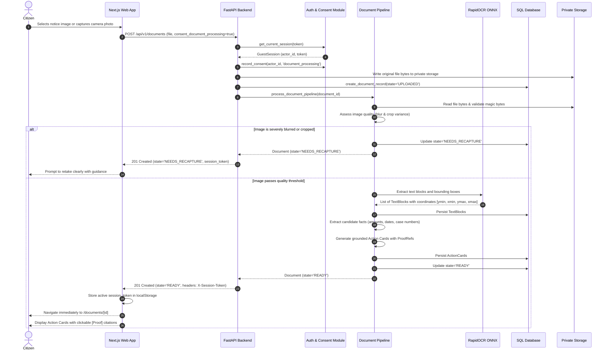
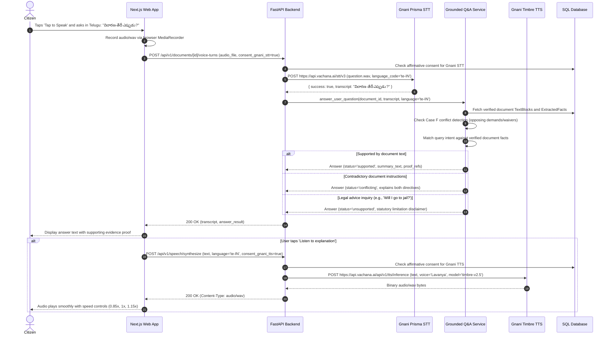
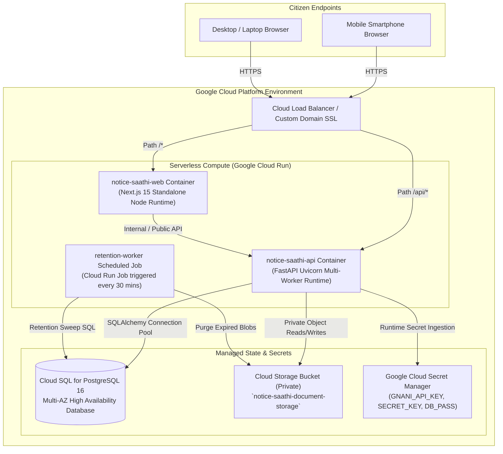

# NoticeSaathi — Architectural Design & System Documentation

> **Core Product Promise: Proof before explanation. Never invent what the evidence does not support.**

---

## 1. System Mission & Philosophy

NoticeSaathi is an evidence-first, voice-enabled document comprehension companion engineered specifically for older adults, individuals with low vision, deaf or hard-of-hearing citizens, and people facing language or literacy barriers.

Unlike generic conversational AI assistants that extrapolate or hallucinate, NoticeSaathi enforces strict deterministic checks: every claim must resolve to verified bounding-box passages in the user's document, high-impact facts (dates, amounts, legal sections, directives) are validated individually, and the system abstains or marks information as uncertain when evidence is absent, ambiguous, or contradictory.

---

## 2. System Context Diagram

```mermaid
flowchart TD
    User["Citizen / Older Adult User"] -->|Uploads Notice (PDF / JPG / PNG)| WebApp["Next.js 15 Web Application\n(Port 3000 / Cloud Run)"]
    User -->|Voice / Text Questions in Telugu / English| WebApp

    subgraph TrustBoundary["NoticeSaathi Secure Processing Boundary"]
        WebApp -->|REST API Calls (X-Session-Token)| APIService["FastAPI Backend Service\n(Port 8000 / Cloud Run)"]
        APIService --> DB[(Database\nSQLite / PostgreSQL)]
        APIService --> Storage["Private Encrypted Storage\n(Local / Google Cloud Storage)"]
        APIService --> OCR["RapidOCR ONNX Engine\n(Local In-Memory Inference)"]
        APIService --> GroundedQA["Grounded Q&A Engine\n(Case F Conflict Logic & Citations)"]
    end

    subgraph ExternalGateways["External Services (Strict Affirmative Consent Required)"]
        APIService -->|Explicit Voice Consent| GnaniSTT["Gnani Prisma v2.5 STT\n(POST https://api.vachana.ai/stt/v3)"]
        APIService -->|Explicit Voice Consent| GnaniTTS["Gnani Timbre v2.5 TTS\n(POST https://api.vachana.ai/api/v1/tts/inference)"]
        APIService -->|Explicit Cloud Consent| CloudTranslate["Optional Cloud Translation\n(Google / Azure / Gemini)"]
    end

    APIService -->|Action Cards with Highlighted Proof| WebApp
    APIService -->|Synthesized Audio Stream .wav| WebApp
    WebApp -->|Audio Playback & WCAG 2.2 AA Visuals| User
```

---

## 3. Component Architecture Diagram

```mermaid
flowchart LR
    subgraph ClientLayer["Frontend Client Layer (Next.js 15 App Router)"]
        UI_Home["Home Page (/)"]
        UI_Upload["Upload Page (/upload)\nFile Picker & Live Camera"]
        UI_Doc["Document View (/documents/[id])\nAction Cards & Proof Highlight"]
        UI_Ask["Ask View (/documents/[id]/ask)\nSpoken & Typed Q&A"]
        UI_History["History View (/history)"]
        UI_Privacy["Privacy View (/privacy)"]
        A11yContext["Accessibility Provider\n(Font Scaling, High Contrast, WCAG 2.2)"]
        APIClient["API Client (`api.ts`)\nSession Sync, Bounded Retry, Polling"]
    end

    subgraph APILayer["API Gateway & Middleware Layer (FastAPI)"]
        MainApp["`services/api/main.py`\nFastAPI Routes & CORS"]
        AuthMiddleware["Session & Token Validator\n(`modules/auth/service.py`)"]
        ConsentGate["DPDP Purpose Consent Enforcement"]
        SafeErrors["Production Error Sanitizer\n(Zero Stack Traces in Prod)"]
    end

    subgraph ServiceLayer["Core Domain Services"]
        DocPipeline["Document Pipeline Service\n(`modules/documents/service.py`)"]
        OCREngine["RapidOCR ONNX Engine\n(`modules/ocr/service.py`)"]
        QualityGate["Quality Evaluator (Laplacian Blur/Glare)"]
        FactService["Entity Normalizer & Fact Extractor\n(`modules/extraction/fact_service.py`)"]
        CitationVal["Citation Validator\n(`modules/citations/validator.py`)"]
        AnswerEngine["Grounded Legal Answering Engine\n(`modules/answers/service.py`)"]
        GnaniSTT["Gnani STT Adapter (`modules/gnani_stt/adapter.py`)"]
        GnaniTTS["Gnani TTS Adapter (`modules/gnani_tts/adapter.py`)"]
    end

    subgraph PersistenceLayer["Storage & Data Layer"]
        SQLStore[(SQL Database\nDocuments, TextBlocks, Facts, ActionCards)]
        BlobStore["Private File Storage\n(Original Files, Rendered Slices, Audio Caches)"]
    end

    APIClient --> MainApp
    MainApp --> AuthMiddleware --> ConsentGate
    ConsentGate --> DocPipeline
    ConsentGate --> AnswerEngine

    DocPipeline --> QualityGate
    QualityGate --> OCREngine
    OCREngine --> FactService
    FactService --> CitationVal
    AnswerEngine --> CitationVal

    DocPipeline --> SQLStore
    DocPipeline --> BlobStore
    AnswerEngine --> SQLStore
    AnswerEngine --> GnaniSTT
    AnswerEngine --> GnaniTTS
```

---

## 4. Document Processing Sequence Diagram



---

## 5. Voice Interaction Sequence Diagram



---

## 6. Google Cloud Run Deployment Architecture Diagram



---

## 7. Main Repository Directories & Responsibilities

| Directory | Responsibilities | Key Technologies |
| :--- | :--- | :--- |
| `apps/web/app/` | Next.js 15 App Router pages: `/`, `/upload`, `/documents/[id]`, `/history`, `/privacy`. | React 19, TypeScript, TailwindCSS v4 |
| `apps/web/components/` | Accessible UI components: `ActionCardComponent`, `ProofModal`, `Navbar`. | Lucide React, Headless accessible elements |
| `apps/web/lib/` | Frontend API client (`api.ts`) and Accessibility context (`accessibility.tsx`). | TypeScript, Web Audio API, LocalStorage |
| `backend/database/` | Database session manager (`session.py`) and schema definitions (`models.py`). | SQLAlchemy 2.0, SQLite / PostgreSQL |
| `backend/modules/answers/` | Question-answering engine with strict Case F conflict rules and abstentions. | Python 3.12, regex, token validation |
| `backend/modules/auth/` | Guest session creation, token validation, and DPDP consent tracking. | Cryptographic tokens, granular scopes |
| `backend/modules/citations/`| Citation integrity engine validating bounding-box coordinate proof. | Python, Bounding Box geometry |
| `backend/modules/documents/`| Document ingestion, PDF rasterization, and image quality assessment. | PyMuPDF, Pillow, Laplacian variance |
| `backend/modules/extraction/`| Structured entity and fact extraction (dates, currencies, directives). | Python regex, deterministic parsers |
| `backend/modules/gnani_stt/`| Gnani Prisma v2.5 Speech-to-Text integration and fallback mock engine. | httpx, multipart form parser |
| `backend/modules/gnani_tts/`| Gnani Timbre v2.5 Text-to-Speech integration and synthetic WAV generator. | httpx, wave, struct audio synthesis |
| `backend/modules/ocr/` | Local Optical Character Recognition without external cloud AI dependencies. | RapidOCR ONNX, numpy |
| `infra/` | Production container definitions and local Docker orchestration. | Dockerfiles, Docker Compose |
| `scripts/` | Standalone maintenance jobs, including expired document cleanup. | Python scripts, cron entry points |
| `services/api/` | FastAPI main application entry point, CORS, routes, and error handling. | FastAPI, Uvicorn, Starlette |
| `tests/` | Comprehensive test suite (unit, integration, security, OCR, translation). | Pytest, pytest-asyncio, PIL fixtures |

---

## 8. Current Local Architecture vs. Production Cloud Run Target

| Architectural Dimension | Current Local Development | Production Target (Google Cloud Run) |
| :--- | :--- | :--- |
| **Backend Runtime** | Python 3.12 Uvicorn process on `127.0.0.1:8000` | Google Cloud Run containerized service (`Dockerfile.api`) |
| **Frontend Runtime** | Node.js Next.js standalone process on `localhost:3000` | Google Cloud Run containerized service (`Dockerfile.web`) |
| **Database** | Local SQLite (`notice_saathi_v2.db`) | Google Cloud SQL for PostgreSQL 16 with private IP connection |
| **File Storage** | Local disk directory (`./data/storage`) | Google Cloud Storage (GCS) private bucket with service account IAM |
| **Secret Management** | Local `.env` file | Google Cloud Secret Manager with IAM secret accessor roles |
| **Data Retention** | On-demand UI purge + standalone script execution | Automated Cloud Run Job invoked every 30 minutes via Cloud Scheduler |
| **Speech APIs** | Gnani Prisma STT & Timbre TTS with offline mock fallbacks | Live Gnani AI production credentials via Secret Manager |
| **CORS Policy** | Permissive local development origins (`localhost:3000`) | Strict production domain origin matching without wildcard |
